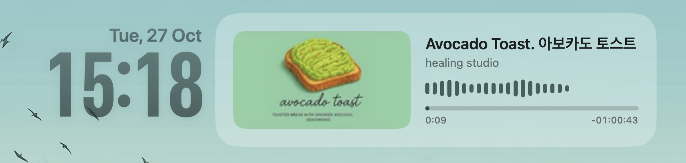

# mini-player

A read-only Liquid Glass card that sits on your macOS desktop wallpaper and shows what is playing. It is decoration, with no controls, and it is click-through. See [docs/PRD.md](docs/PRD.md).



> **Status: v0.3.** The card shows artwork, a scrolling title and artist, animated waves, and a progress bar with times, plus an optional lock-screen-style clock beside it. Everything about the look is changeable in Settings and in one JSON file.

**Requires macOS 26 and the Xcode command line tools.**

## Build and run

Reading now-playing info on macOS 15.4+ relies on [`ungive/mediaremote-adapter`](https://github.com/ungive/mediaremote-adapter) (BSD-3), which runs through the entitled `/usr/bin/perl`. This is a private-API workaround and can break on an OS update. The app checks it at launch and shows "Now playing unavailable" in the menu if it does not work.

```sh
brew install cmake            # once
scripts/build-adapter.sh      # fetches and builds the pinned adapter into vendor/
scripts/build-app.sh          # assembles build/MiniPlayer.app (ad-hoc signed)
open build/MiniPlayer.app
```

Use the waveform icon in the menu bar to hide or show the widget, change its position, open **Settings** (⌘,), or reveal the config file.

- **Change Position** (in the menu bar menu) puts the card on one of nine points of the rule-of-thirds grid: Center, Center - Left, Center - Right, Center - Top, Center - Bottom, Top - Left, Top - Right, Bottom - Left, Bottom - Right. It is the **center of the player and the clock together** that lands on the point. **Custom** keeps the card where it is and lets you drag it anywhere (it floats above your windows while you do; choose Custom again to finish). Dropped close to one of the nine points it snaps there. Settings > Position has the same nine points as a small map. Opening Settings turns dragging on, so you see every change live.
- **Background** can be Liquid Glass, a frosted blur (pick a macOS blur material), or nothing at all, with its own opacity and an optional tint. Content stays fully opaque. Hiding elements keeps what is left centered in the card.
- **The accent color** (progress bar and waves) can come from the artwork (the default), be tinted from the wallpaper behind the card, or be a custom or plain color. **The clock's color** is tinted from the wallpaper by default, like the lock screen's: it takes the wallpaper's hue behind it and a lightness that stands out. To see that wallpaper it needs the **Screen Recording** permission (System Settings > Privacy & Security > Screen & System Audio Recording). It only captures the wallpaper window, never your windows, and macOS needs mini-player restarted after you allow it. Because the app is signed ad hoc, macOS may ask again after you rebuild it. Choose "Custom color" in Settings > Clock to skip all of this.
- **The clock** sits just outside the card at one of twelve anchors (above, below, left or right, each aligned start, center or end) and follows the card. It is never larger than the card, the date can sit above or below the time with its own alignment, and it stays on the desktop when nothing is playing.

## Configuration

Settings are saved to `~/Library/Application Support/mini-player/config.json` and the file is the source of truth: edit it by hand while the app runs and the widget updates within a second. A missing key takes its default, a wrong value falls back to its default, and numbers are clamped to sensible ranges. If the file is not valid JSON at launch, the app starts with defaults and keeps your original as `config.json.bak`. To share a look, share the file.

The groups are `card`, `background`, `accent`, `text`, `elements`, `waves`, `clock`, `position` and `general`; the file written on first run lists every key. Set `MINIPLAYER_CONFIG_DIR` to use a different folder.

## Develop

```sh
swift test                    # core logic tests
swift build                   # then run .build/debug/MiniPlayer with the adapter paths set:
```

Without an app bundle, point at a built adapter checkout:

```sh
A=vendor/mediaremote-adapter
MINIPLAYER_ADAPTER_SCRIPT=$A/bin/mediaremote-adapter.pl \
MINIPLAYER_ADAPTER_FRAMEWORK=$A/build/MediaRemoteAdapter.framework \
MINIPLAYER_ADAPTER_TESTCLIENT=$A/build/MediaRemoteAdapterTestClient \
.build/debug/MiniPlayer
```

## License

MIT, see [LICENSE](LICENSE). The now-playing adapter that gets bundled into the app is BSD-3-Clause, see [THIRD_PARTY_LICENSES](THIRD_PARTY_LICENSES). The build script also copies its license into the app bundle.
